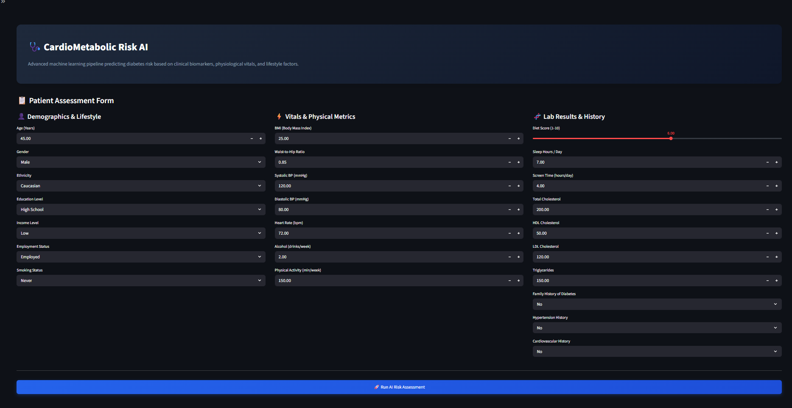

# 🩺 Health Risk & Diabetes Prediction App

A machine learning pipeline and web application built to predict diabetes risk using comprehensive health, lifestyle, and clinical indicators. 

This project explores a large-scale health dataset (~700,000 records) to train, evaluate, and compare multiple classification models, making it easy to analyze risk factors and view predictions through an interactive interface.

---

## 📸 App Preview

<p align="center">
  
</p>

---

## 🚀 What's Inside?
* **Robust Data Preprocessing:** Uses `scikit-learn` pipelines with `StandardScaler` for continuous features and `OneHotEncoder` for categorical demographics.
* **Model Benchmarking:** Evaluates and compares multiple algorithms:
  * **Logistic Regression** (Baseline linear model)
  * **Gaussian Naive Bayes** (Probabilistic approach)
  * **Gradient Boosting Classifier** (Ensemble method for higher predictive performance)
* **Comprehensive Metrics:** Evaluated using accuracy, precision, recall, F1-score, and confusion matrices.

---

## 📊 Dataset Overview
The model is trained on a synthetic health dataset containing **700,000 rows** and **26 features**, covering a wide spectrum of lifestyle and clinical attributes:
* **Demographics & Socioeconomics:** Age, gender, ethnicity, education level, income level, employment status.
* **Lifestyle Habits:** Alcohol consumption, physical activity minutes, sleep hours, daily screen time, smoking status.
* **Biometric & Clinical Vitals:** BMI, waist-to-hip ratio, systolic/diastolic blood pressure, heart rate, total cholesterol, HDL/LDL cholesterol, triglycerides.
* **Medical History:** Family history of diabetes, hypertension history, cardiovascular history.
* **Target Variable:** `diagnosed_diabetes` (Binary classification).

---

## ⚙️ Model Performance Summary

| Model | Accuracy | F1-Score (Class 1) | Notes |
| :--- | :---: | :---: | :--- |
| **Logistic Regression** | ~66% | 0.76 | Solid baseline with balanced convergence. |
| **Gaussian Naive Bayes** | ~62% | 0.67 | Fast probabilistic baseline. |
| **Gradient Boosting** | *Tuned in code* | *Ensemble* | Captures complex non-linear health interactions. |

---

## 🛠️ Project Structure

```text
├── .gitignore                      # Prevents cache/junk files from being tracked
├── README.md                       # Main portfolio documentation & project showcase
├── requirements.txt                # Dependencies for Streamlit Cloud deployment
├── screenshot.png                  # App Preview image
|
├── notebooks/                      # 📓 Folder for all Jupyter Notebooks
│   └── diabetes_eda_and_modeling.ipynb
│
├── model/                          # 🧠 Folder for serialized model artifacts
│   └── diabetes_pipeline_model.pkl
│
├── data/                           # 📊 Folder for datasets
│   └── train.csv
│
└── src/                            # 🚀 Folder for application source code
    └── app.py
```

---

## 💻 Getting Started Locally

If you want to run the Jupyter notebook or spin up the web app on your local machine, follow these steps:

1. **Clone the repository:**
   ```bash
   git clone https://github.com/joyroy9454/diabetes-risk-intelligence.git
   cd diabetes-risk-intelligence
   ```

2. **Install dependencies:**
   ```bash
   pip install -r requirements.txt
   ```

3. **Run the web app:**
   ```bash
   streamlit run app.py
   ```
   *(or run your respective app entry point)*

---

## 💡 Future Improvements
* Tuning hyperparameters via `GridSearchCV` to squeeze out better recall for high-risk patients.
* Deploying the app live on Hugging Face Spaces or Render.
* Adding feature importance plots to explain *why* a specific prediction was made.

---

## 🤝 Contributing
Feel free to open an issue or submit a pull request if you have ideas for improving the models or cleaning up the codebase!